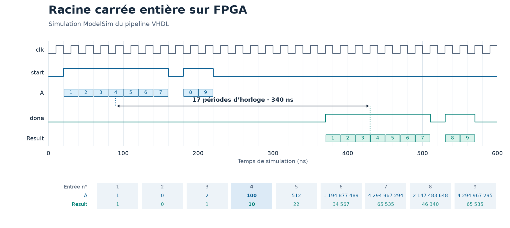

# Calcul de racine carrée sur FPGA

## Objectif

Calculer la partie entière de la racine carrée d’un entier non signé de 32 bits et comparer plusieurs façons de réaliser ce calcul en VHDL.

## Réalisation

Le [cœur VHDL](src/sqrt_core.vhd) rassemble cinq architectures. Les trois premières réutilisent la logique de calcul sur plusieurs fronts d’horloge. La quatrième déroule le calcul en logique combinatoire. La cinquième répartit les étapes du calcul dans un pipeline et propage un indicateur de validité avec chaque valeur.

Le pipeline lit une entrée quand `start` est à 1 au front montant de `clk`. Il indique que `Result` est valide avec `done`. Il peut accepter une entrée à chaque front montant.

## Résultats vérifiés

Les **7 entrées du banc d’origine** donnent les racines entières attendues dans ModelSim. Le [banc autonome](sim/pipeline_tb.vhd) reproduit ces cas et en ajoute deux, dont la valeur maximale sur 32 bits, `4 294 967 295`. Il vérifie **9 résultats sur 9**, ainsi que la validité des sorties après un cycle sans nouvelle entrée.

La latence du pipeline est de **17 périodes entre le front d’acceptation et le front de sortie**, soit **340 ns** avec l’horloge de simulation de 20 ns. Cela correspond à 18 fronts montants en comptant les deux extrémités.

Le rapport historique Quartus du pipeline pour le **Cyclone II EP2C20F484C7** indique **1 161 éléments logiques** et une **Fmax estimée à 162,76 MHz**. L’analyse TimeQuest indique une marge de setup négative de **−5,144 ns** dans le modèle lent. La fréquence cible de cet essai n’a donc pas été validée.

## Chronogramme



Les numéros relient chaque valeur d’entrée à son résultat. L’exemple mis en évidence montre l’entrée `100` acceptée à **90 ns** et le résultat `10` disponible à **430 ns**.

## Relancer la simulation

Depuis la racine du dépôt, avec ModelSim accessible dans le terminal, lancer la commande suivante. Le test a été vérifié avec ModelSim Altera Starter Edition 10.1d sous Windows.

```text
vsim -c -do sim/run.do
```

Le banc vérifie la propriété `q² ≤ A < (q + 1)²` et contrôle que `done` arrive au cycle attendu. Il génère `build/modelsim/pipeline.csv` et `build/modelsim/pipeline.vcd`. Pour régénérer le chronogramme PNG, installer Matplotlib puis lancer la commande suivante.

```text
python sim/plot_waveform.py
```

## Provenance

Projet réalisé à Polytech Paris-Saclay. L’archive de départ retrouvée contient le module carte `top.vhd`, les configurations DE1/Quartus, le système Nios II et un programme C de départ. Le cœur `sqrt_core.vhd` et les bancs VHDL apparaissent dans les versions de travail. Le dépôt rassemble le cœur VHDL et les outils de simulation autonome.
